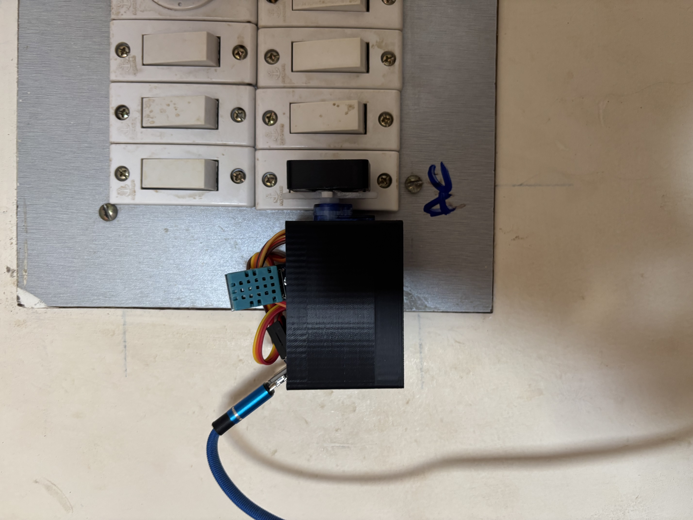
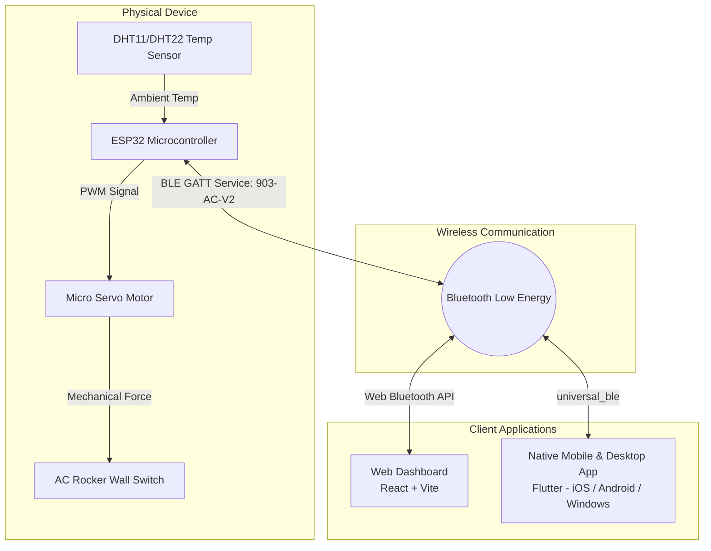

# ❄️ Auto AC Device — Aura Climate

> **A non-invasive, Bluetooth Low Energy (BLE) smart climate automation system and physical switch actuator for air conditioners.**

Transform any conventional wall-switch AC into an automated, smart climate control system — with **zero high-voltage rewiring**, **zero cloud dependencies**, and **zero wall damage**.

---

## 📸 The Physical Hardware in Action

<div align="center">
  <table border="0">
    <tr>
      <td align="center" width="50%">
        
        <br />
        <em><b>Close-up:</b> 3D-printed enclosure, micro-servo mechanical actuator arm, and onboard DHT temperature sensor retrofitted directly over the AC rocker switch.</em>
      </td>
      <td align="center" width="50%">
        
        <br />
        <em><b>Full Installation:</b> Non-invasive wall mount powered via 5V USB adapter, operating alongside existing fan regulators and lighting controls.</em>
      </td>
    </tr>
  </table>
</div>

---

## 💡 The Core Idea & Motivation

### The Problem
Most room air conditioners are connected to high-voltage manual wall switches. Making them "smart" traditionally requires:
- Tearing into electrical switchboards and dealing with dangerous 220V/110V mains wiring.
- Expensive smart relays that void warranties or require licensed electricians.
- Rental constraints where modifying electrical infrastructure is strictly prohibited.
- Cloud-dependent smart plugs that fail when internet connectivity drops.

### The Non-Invasive Solution
**Auto AC Device (Aura Climate)** solves this with a **physical, mechanical retrofit**:
1. **Zero Mains Wiring:** A custom 3D-printed enclosure mounts externally right over the existing AC rocker switch.
2. **Physical Robotic Actuation:** A micro servo motor mechanically moves an actuator arm to physically flip the switch ON and OFF.
3. **Real-Time Environmental Sensing:** An external DHT sensor continuously measures ambient room temperature and humidity.
4. **Local Bluetooth Low Energy (BLE):** Powered by an ESP32 microcontroller broadcasting directly over BLE GATT (`903-AC-V2`) with ultra-low latency and total local privacy.
5. **Intelligent Closed-Loop Climate Control:** 
   - Set your desired room temperature via the web dashboard or mobile app.
   - When the room warms up past your target setpoint, the servo turns the AC **ON**.
   - Once the room cools down to the set temperature (with built-in hysteresis to prevent rapid cycling), the servo flips the AC **OFF**, maintaining comfort while significantly reducing electricity bills.

---

## 🏗️ System Architecture



---

## 📡 BLE Protocol & GATT Architecture

The ESP32 acts as a BLE peripheral advertising as **`903-AC-V2`** (or `903-AC`):

| Parameter | UUID / Value | Direction | Data Format | Description |
|---|---|---|---|---|
| **Primary Service** | `12345678-1234-1234-1234-123456789000` | GATT Service | 128-bit UUID | Primary Aura AC Service |
| **Ambient Temperature** | `12345678-1234-1234-1234-123456789001` | Read / Notify | 32-bit Float (LE) or ASCII (`"24.5"`) | Real-time temperature from DHT sensor |
| **Target Setpoint** | `12345678-1234-1234-1234-123456789002` | Read / Write | UTF-8 String (e.g., `"72.0"`) | Desired target temperature set by user |
| **Power & Servo Control** | `12345678-1234-1234-1234-123456789003` | Read / Write | UTF-8 String (`"on"`, `"off"`, or angle) | Manual power toggle / direct servo position |

---

## 📱 Software Interfaces

The project provides two independent control interfaces tailored for different user setups:

### 1. Web Dashboard (`/web_app`)
- **Tech Stack:** React, Vite, Tailwind CSS.
- **Direct Web Bluetooth:** Connect directly from Chrome, Edge, or any Web Bluetooth-enabled browser without installing anything.
- **Features:** Temperature dials, live telemetry graphs, schedule automation, target setpoint slider, and manual override.

### 2. Native Mobile & Desktop App (`/native_app`)
- **Tech Stack:** Flutter, Dart, `universal_ble`.
- **Supported Platforms:** iOS, Android, and Windows.
- **Features:** Native background Bluetooth scanning, automatic reconnection, smooth animations, and system status indicators.
- **CI/CD:** Automated GitHub Actions build pipeline that produces signed iOS IPAs and Android APKs on every release.

---

## 📁 Repository Structure

```text
Dashboard/
├── IMG_0869 (1).jpeg     # Switchboard installation photograph
├── IMG_0870.jpeg         # Close-up photograph of the 3D-printed servo actuator
├── README.md             # Project documentation (this file)
├── AI.md                 # AI development workflow & technical guidelines
├── .github/
│   └── workflows/
│       └── build_native_apps.yml   # Multi-platform CI/CD for Flutter builds
├── native_app/           # Flutter native client (iOS, Android, Windows)
│   ├── lib/              # Flutter Dart application code
│   ├── HOW.md            # Sideloading, installation, and Bluetooth guide
│   └── pubspec.yaml      # Dependencies & app configuration
└── web_app/              # React + Vite web dashboard
    ├── src/              # React components, Bluetooth manager, & hooks
    ├── firmware/         # ESP32 Arduino firmware (Bluetooth.h)
    ├── README.md         # Web Bluetooth usage guide
    └── package.json      # NPM dependencies & scripts
```

---

## 🚀 Quick Start Guide

### Running the Web Dashboard
```bash
# Navigate to web application directory
cd web_app

# Install dependencies
npm install

# Start local development server
npm run dev
```
Open [http://localhost:5173](http://localhost:5173) in Google Chrome or Microsoft Edge and tap **Connect AC**.

### Running the Flutter Native App
```bash
# Navigate to native application directory
cd native_app

# Ensure Flutter is installed and healthy
flutter doctor

# Run on Windows Desktop
flutter run -d windows

# Or run on connected Android/iOS device
flutter run
```

### Flashing the ESP32 Firmware
1. Open the Arduino IDE.
2. Ensure you have the `ESP32` board definitions and `DHT` sensor libraries installed.
3. Include the firmware header located at `web_app/firmware/Bluetooth.h`.
4. Flash the sketch to your ESP32 board over USB.

---

## 🔒 Safety & Benefits

- **Non-Invasive:** Simply mount or remove the device at any time without leaving marks or cutting wires.
- **Electrical Isolation:** The electronics are completely isolated from high-voltage AC mains; all logic runs safely on 5V DC.
- **Local-First Privacy:** No cloud accounts, subscriptions, or external servers required. Direct peer-to-peer Bluetooth communication.
